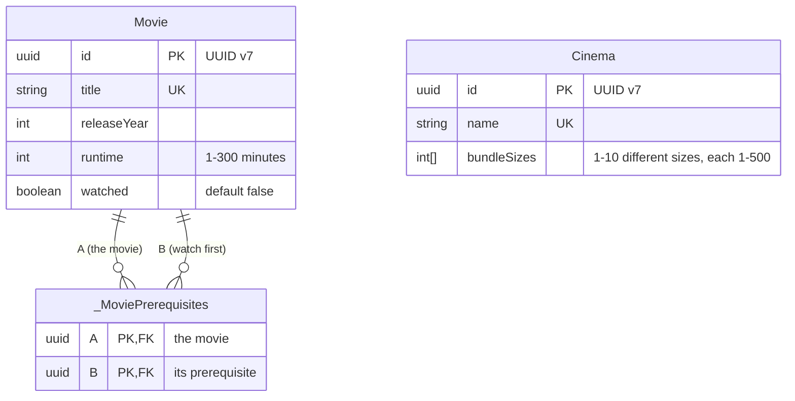

# Doomsday Ready

A small full-stack app that helps MCU fans plan their rewatch before *Avengers: Doomsday* and book an
opening-night watch party.

| Layer | Stack |
| --- | --- |
| Backend | Node.js 22, Express 5, Prisma ORM, PostgreSQL 17, Zod (request validation) |
| Frontend | React 19, Vite, Tailwind CSS 4, axios, zustand |
| Tooling | Docker Compose, Node's built-in test runner |

## Quick start (Docker, one command)

```bash
docker compose up --build
```

Open **http://localhost:8080**. On first start the database is migrated and loaded with the sample data
from the assessment (8 movies, 4 cinemas).

## Run locally without Docker for the app

Requires Node.js 22+. Postgres still runs in Docker (on host port **5433**, so it does not clash with
a locally installed Postgres).

```bash
# 1. Database
docker compose up -d db

# 2. API on http://localhost:3000
cd backend
cp .env.example .env
npm install
npx prisma migrate deploy
npm run db:seed
npm run dev

# 3. UI on http://localhost:5173 (proxies /api to the API), in a second terminal
cd frontend
npm install
npm run dev
```

Tests for the two algorithms: `cd backend && npm test`

## Features

### 1. Movies and rewatch order
- Create movies with a unique title, release year, runtime (1–300 min), optional prerequisites and a
  `watched` flag (default `false`). Prerequisites and `watched` can be changed later.
- Any create or update that would make a movie depend on itself, directly or through other movies, is
  rejected with **`409 CIRCULAR_DEPENDENCY`**.
- The rewatch order for a target movie lists every direct and indirect prerequisite exactly once, each
  after its own prerequisites, without the target. It also returns how many are watched and the total
  runtime of the unwatched ones.

### 2. Cinemas and watch-party booking
- Create cinemas with a unique name and 1–10 different bundle sizes (1–500 seats each).
- A booking quote for a group of 1–10,000 returns the fewest bundles that add up to exactly the group
  size and how many of each to buy, or says that no exact combination exists.

### 3. Frontend
- **Movies:** add movies, edit prerequisites, tick movies as watched.
- **Rewatch Plan:** pick a target, see the ordered list with watched ticks, a progress bar
  ("4 of 7 watched") and the remaining watch time.
- **Booking:** pick a cinema, enter a group size, see the bundles to buy or "Not possible".
  Add a cinema on the same page (name and bundle sizes, e.g. `2, 5`); it is selected right away.
- **Reset data** (header button): restores the sample data for demos.

## How the logic works

Both algorithms are written by hand, without libraries, in [`backend/src/lib/`](backend/src/lib/).

**Circular dependency check** ([`graph.js`](backend/src/lib/graph.js), `wouldCreateCycle`).
Before saving new prerequisites for movie *M*, walk backwards from those prerequisites through their own
prerequisites (iterative depth-first search with a stack and a visited set). If the walk reaches *M*,
the change would create a cycle. A newly created movie has no dependents yet, so only updates need this
check. The check and the save run in one `Serializable` transaction, so two simultaneous edits cannot
together create a cycle.

**Rewatch order** ([`graph.js`](backend/src/lib/graph.js), `rewatchOrder`).
Depth-first search from the target: before a movie is added to the list, all of its prerequisites are
visited and added first (post-order). A visited set makes sure each movie appears once, and the target is
never added. Because cycles are rejected on write, the graph is always acyclic.

**Booking quote** ([`bundles.js`](backend/src/lib/bundles.js), `minBundles`).
Dynamic programming, the unbounded "coin change" problem. `best[n]` is the fewest bundles that give
exactly `n` seats: `best[0] = 0`, and `best[n] = min(best[n - size] + 1)` over all bundle sizes.
The last bundle used for each `n` is remembered, so the answer is rebuilt by walking back from the group
size. Cost: O(groupSize × number of sizes), at most 10,000 × 10 steps.

## Data model



- **`Movie`** prerequisites are a self many-to-many relation (`prerequisites` / `requiredBy`), using
  Prisma's implicit many-to-many. Prisma manages the join table `_MoviePrerequisites` itself: each row
  means "watch `B` before `A`". The pair `(A, B)` is unique, so the same link can't be added twice, and
  both foreign keys use `ON DELETE CASCADE`.
- **`Cinema`** is independent of movies. Bundle sizes are stored as a Postgres integer array because
  they are a small, fixed list that is always read together with the cinema.
- Ids are **UUID v7**: hard to guess like any UUID, but time-ordered, so indexes stay efficient and
  sorting by id gives creation order.

Schema: [`backend/prisma/schema.prisma`](backend/prisma/schema.prisma)

## API reference

All endpoints are under `/api`.

| Method and path | Purpose |
| --- | --- |
| `POST /movies` | Create a movie |
| `GET /movies` | List movies |
| `PATCH /movies/:id` | Update a movie, including `watched` and `prerequisites` |
| `GET /movies/:id/rewatch-order` | Rewatch order (feature 1) |
| `POST /cinemas` | Create a cinema |
| `GET /cinemas` | List cinemas |
| `GET /cinemas/:id/booking?groupSize=6` | Booking quote (feature 2) |
| `POST /admin/reset` | Extra: reset to the sample data. Not mounted when `NODE_ENV=production` |

Every response has the same envelope:

```jsonc
// success
{ "success": true, "message": "Movie created", "data": { ... } }
// error
{ "success": false, "code": "CIRCULAR_DEPENDENCY", "message": "A movie cannot depend on itself, directly or indirectly" }
```

| Status | Code | When |
| --- | --- | --- |
| 400 | `VALIDATION_ERROR` | Invalid body, id or query, or a prerequisite that does not exist |
| 404 | `NOT_FOUND` | Unknown movie, cinema or route |
| 409 | `CIRCULAR_DEPENDENCY` | The change would make a movie depend on itself |
| 409 | `DUPLICATE` | Title or cinema name already taken |
| 409 | `CONFLICT` | Two updates collided at the same moment; retry |

<details>
<summary>Request and response examples</summary>

```http
POST /api/movies
{ "title": "Avengers: Doomsday", "releaseYear": 2026, "runtime": 150, "prerequisites": ["<endgame-id>"] }
```

```http
PATCH /api/movies/:id
{ "watched": true }                 // fields not sent stay unchanged
{ "prerequisites": ["<id>", "<id>"] } // replaces the whole list
```

```http
GET /api/movies/:id/rewatch-order
→ data: { "target": { "id", "title" }, "order": [movie, ...], "totalCount": 7, "watchedCount": 4, "remainingRuntime": 460 }
```

```http
POST /api/cinemas
{ "name": "Grand Cinema", "bundleSizes": [2, 5] }
```

```http
GET /api/cinemas/:id/booking?groupSize=11
→ data: { "cinema": { "id", "name" }, "groupSize": 11, "possible": true, "totalBundles": 4,
          "bundles": [{ "size": 5, "count": 1 }, { "size": 2, "count": 3 }] }
→ when impossible: { ..., "possible": false, "totalBundles": null, "bundles": [] }
```

</details>

## Project structure

```
backend/
  prisma/
    schema.prisma        data model
    migrations/          SQL migrations
    seed.js              loads sample data into an empty database
  src/
    config/              Prisma client
    data/                sample movies and cinemas from the assessment
    routes/              URL -> controller
    controllers/         validate the request, call a service, send the response
    validators/          Zod schemas for bodies, params and queries
    services/            business rules and database access
    lib/                 the two hand-written algorithms (graph.js, bundles.js)
    middleware/          404 and global error handler
    utils/               sendResponse, HttpError
  test/                  unit tests for the algorithms
frontend/src/
  api/                   axios client and endpoint functions
  store/                 zustand store for movies (shared by two pages)
  pages/                 Movies, Rewatch Plan, Booking
  components/            feature components and small ui/ primitives
docker-compose.yml       db + backend + frontend (nginx serves the UI and proxies /api)
```


## How I used AI

I used Claude Code (Anthropic's AI coding assistant) while building this project:

- **Scaffolding:** I used it to scaffold the project structure, the backend layers (routes, controllers,
  services, validators, error handling), the Prisma schema and the React frontend.
- **My decisions:** I chose the stack and design changes, and asked it to apply them. These included
  moving from SQLite to Prisma with PostgreSQL, Tailwind CSS for the UI, axios and zustand on the
  frontend, UUID v7 ids, a single success/error response format, the cinema form and the reset-data
  button.
- **Review and testing:** I reviewed the code, asked for explanations of parts I wanted to understand,
  and checked every expected result from the assessment against the running app.
